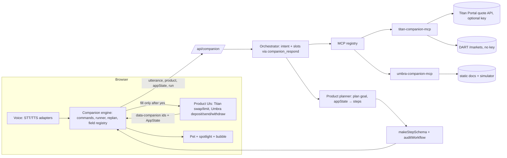

# Target architecture



## Key contracts (TypeScript, to be implemented)
```ts
// lib/companion/engine/types.ts
type ProductId = "titan" | "umbra";
type IntentType = "act"|"learn"|"explain"|"diagnose"|"compare"|"explore"|"modify"|"resume"|"cancel"|"chat";
interface Intent { type: IntentType; product: ProductId | "general"; goal?: string; slots: Record<string,string> }
interface RunContext { goal: string; slots: Record<string,string>; stepIndex: number; status: "running"|"waiting_input"|"waiting_action"|"error" }

interface ProductAdapter<S> {
  id: ProductId;
  registry: Registry;                       // pages + elements (data-companion ids)
  appStateSchema: z.ZodType<S>;              // non-sensitive snapshot only
  goals: Record<string, (slots, state: S) => Step[]>;   // deterministic planners
  promptFragment(state: S): string;          // compact, < 400 tokens
  toolPrefix: "titan_" | "umbra_";
  voice: { sttPrompt: string; corrections: [RegExp, string][]; spokenTickers: string[] };
  rules(utterance: string, state: S): Intent | null;     // no-LLM fallback
}
```

## Step vocabulary (data only, never code)
`navigate_to_page | point | explain | request_input | observe | call_tool | wait_for_user_action | stop_before_signing | celebrate`
- `skipIf?: { state: <path>, equals?: string, exists?: boolean }` lets a step be skipped when the user already did it.
- `observe: { until: <same predicate>, timeoutMs }` waits for the UI state, e.g. a quote has loaded.

## Turn flow
1. **Local command?** `parseControlCommand` handles stop, back and the others locally, with no network.
2. **Network turn:** POST `{utterance, product, appState, run, history}`.
3. **LLM:** sees only the product's tools plus `companion_respond {speech, intent, product, slots, point_target?, custom_steps?}`.
4. **Server reaction by intent:**
   - `act` → `adapter.goals[goal](slots, appState)` gives steps → validated.
   - `modify` → merge slots into `run` and re-plan from the current state; the runner continues at the first unsatisfied step.
   - `learn`/`explain`/`diagnose`/`compare` → speech, plus an optional point or `call_tool` reads. **No workflow.**
   - `cancel` → stop.
   - A product switch → `navigate_to_page` to that product.
5. **Browser:** re-audits and runs the steps; questions during a run are answered without dropping it (the run is paused, then resumed).

## MCP servers (read-only; tool provenance `live | derived | static-docs | mock`)

**titan-companion-mcp**
| Tool | Source |
|---|---|
| `titan_get_quote(inputMint, outputMint, amount, slippageBps?)` | Portal (live) or mock |
| `titan_list_dart_markets()` | DART `/markets` (live) |
| `titan_explain_concept(topic)` | Static docs: Argos, DART, Prime, Manual, slippage, priority fee, MEV protect, price impact, limit, DCA, Slice, private swap |
| `titan_explain_quote(quote)` | Derived: why fewer tokens out (fees, impact, slippage) |
| `titan_validate_limit_order(...)` | Derived: $10 minimum, limit price not worse than market |
| `titan_diagnose_error(code\|message)` | Static: Portal errors, simulation failure, insufficient SOL |
| `titan_get_documentation(topic)` | Static: links into the GitBook |

**umbra-companion-mcp**
| Tool | Source |
|---|---|
| `umbra_explain_concept(topic)` | Static: private account, registration, platform wallet, notes, deposit, private send, withdraw, relayer, fees, screening, disclosure |
| `umbra_privacy_report(operation)` | Static: what is public vs hidden, with the documented leaks |
| `umbra_check_transfer_readiness(state)` | Derived from the simulated state: sender registered, recipient registered, balance, token supported |
| `umbra_list_supported_tokens()` | Static list, labelled |
| `umbra_diagnose_error(code)` | Static: the documented error codes |
| `umbra_get_documentation(topic)` | Static links |

There are no account-status tools against real chains: account state is the simulated `AppState`.

## Security boundaries
- **The LLM never sees** keys, signatures or seed phrases (none exist in the demo). `AppState` schemas whitelist fields.
- **Browser actions** are only the step vocabulary over registered ids.
  - `sensitive` controls are wait-only.
  - Fills require an explicit "yes".
  - `stop_before_signing` is last.
- **Titan API key** lives only in the MCP server process env, and never reaches the client.
- **Rate limits** stay on every API route. The Titan Portal Sandbox allows 1 request/second, so quotes are cached for 2 seconds and requests coalesced.
- **Every simulated value** shows a "Simulated" badge, and mock tool results carry `simulated: true`.
